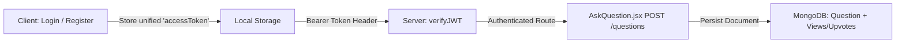
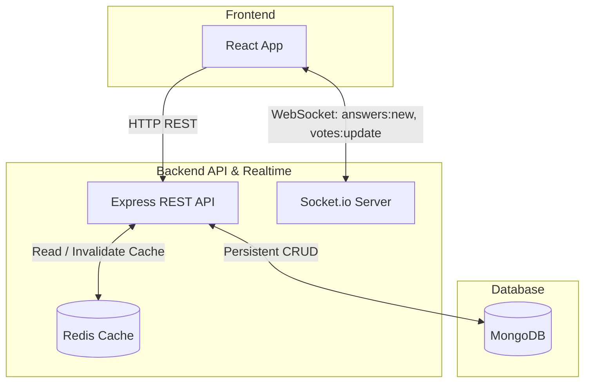
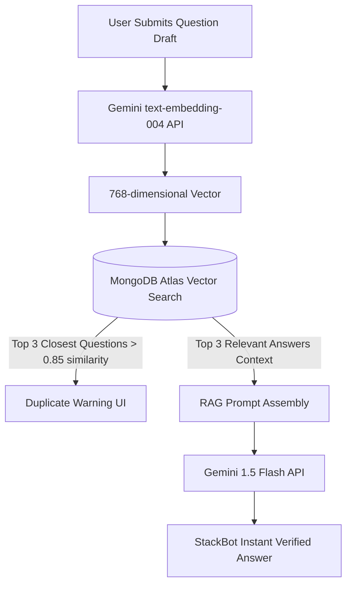

# Askora Master Evolution Plan: From C+ Hackathon MVP to S-Tier Platform

This comprehensive implementation plan details the step-by-step engineering roadmap to transform **Askora** from an incomplete hackathon prototype into an **S-Tier, production-ready, AI-augmented developer Q&A platform**.

---

## 📅 Roadmap Overview & Timeline

| Phase | Focus Area | Target Tier | Estimated Timeline | Core Deliverable |
| :--- | :--- | :---: | :---: | :--- |
| **Phase 1** | **Foundation & Core Loop Repair** | **B+ Tier** | **3 – 4 Days** | End-to-end working CRUD, repaired server, real question submission, uniform auth |
| **Phase 2** | **Scalability, Real-Time & DevOps** | **A Tier** | **5 – 7 Days** | WebSockets (Socket.io), Redis caching, Docker containerization, CI/CD with GitHub Actions |
| **Phase 3** | **AI Intelligence, RAG & Auto-Correction** | **S Tier** | **6 – 8 Days** | RAG vector search (duplicate detection), AI first-responder, "Improve with AI" editor, auto-tagging ($0 cost) |

---

## User Review Required

> [!IMPORTANT]
> **Zero-Cost Constraint**: Phase 3 uses exclusively free-tier services: **Google Gemini API** (`gemini-1.5-flash` and `text-embedding-004`) and **Groq Cloud API** (`llama-3.3-70b`). No paid subscriptions or credit cards are required.
> 
> **Database**: Vector search will utilize **MongoDB Atlas Vector Search** directly within your existing MongoDB cluster, eliminating the need to manage a separate external vector database (e.g., Pinecone).
>
> **Hosting**: Frontend deploys to **Vercel**; Backend deploys to **Render** or **Railway** (to support persistent WebSockets connections).

---

## Phase 1: Foundation & Core Loop Repair (Days 1 – 4)

### Objective
Restore the broken backend, connect the client's mocked components to real REST endpoints, eliminate token inconsistencies, fix database schemas, and establish environment variable standards.

### Proposed Changes

#### [MODIFY] [server/app.js](file:///d:/Code/Projects/StackIt/server/app.js)
* **Rationale:** Currently empty (0 bytes), which crashes `server.js` immediately.
* **Implementation:**
  * Re-instantiate Express application.
  * Configure CORS middleware allowing `process.env.CORS_ORIGIN || 'http://localhost:5173'` with `credentials: true`.
  * Add `express.json({ limit: "16kb" })`, `express.urlencoded({ extended: true, limit: "16kb" })`, and `cookieParser()`.
  * Mount routers:
    * `/api/v1/users` $\rightarrow$ `userRouter`
    * `/api/v1/questions` $\rightarrow$ `questionRouter`
    * `/api/v1/answers` $\rightarrow$ `answerRouter`
  * Export `{ app }`.

#### [MODIFY] [server/models/question.models.js](file:///d:/Code/Projects/StackIt/server/models/question.models.js)
* **Rationale:** Missing fields used by controllers (`views`, `upvotes`).
* **Implementation:**
  * Add `views: { type: Number, default: 0 }`.
  * Add `upvotes: [{ type: Schema.Types.ObjectId, ref: 'User' }]`.
  * Add `downvotes: [{ type: Schema.Types.ObjectId, ref: 'User' }]`.

#### [MODIFY] [server/models/notification.models.js](file:///d:/Code/Projects/StackIt/server/models/notification.models.js)
* **Rationale:** CommonJS syntax (`require`/`module.exports`) breaks ES Module runtime (`"type": "module"` in `package.json`).
* **Implementation:**
  * Refactor to `import mongoose, { Schema } from "mongoose";` and `export const Notification = mongoose.model("Notification", notificationSchema);`.

#### [MODIFY] [Client/src/components/AskQuestion.jsx](file:///d:/Code/Projects/StackIt/Client/src/components/AskQuestion.jsx)
* **Rationale:** Submitting questions is currently simulated with `setTimeout(1000)`.
* **Implementation:**
  * Wire `handleSubmit` to make an authenticated `POST` request to `/api/v1/questions/createQuestion` (or `/api/v1/questions`).
  * Attach `Authorization: Bearer <token>` from localStorage.
  * On success, navigate to the newly created question page or dashboard.

#### [MODIFY] [Client/src/components/Login.jsx](file:///d:/Code/Projects/StackIt/Client/src/components/Login.jsx) & [Dashboard.jsx](file:///d:/Code/Projects/StackIt/Client/src/components/Dashboard.jsx) & [AnswerPage.jsx](file:///d:/Code/Projects/StackIt/Client/src/components/AnswerPage.jsx)
* **Rationale:** Token key mismatch (`token` vs `accessToken`).
* **Implementation:**
  * Standardize on `accessToken` across all storage and retrieval operations.
  * In `Login.jsx`: Read `data.data.tokens.accessToken` and store as `localStorage.setItem('accessToken', ...)`.
  * Update `AnswerPage.jsx` and `api.js` to look for `accessToken`.

#### [MODIFY] [Client/src/services/api.js](file:///d:/Code/Projects/StackIt/Client/src/services/api.js) & Component API URLs
* **Rationale:** Eliminate hardcoded `http://localhost:8000` URLs across all components.
* **Implementation:**
  * Create `Client/.env` with `VITE_API_BASE_URL=http://localhost:8000/api/v1`.
  * Read `import.meta.env.VITE_API_BASE_URL` in `api.js` and all `fetch` calls.

---

## Phase 2: Scalability, Real-Time & DevOps (Days 5 – 11)

### Objective
Elevate the architecture to production standards: real-time updates via WebSockets, high-throughput caching via Redis, containerized environments via Docker, and automated CI/CD via GitHub Actions.

### Proposed Changes

#### 1. Real-Time Layer (Socket.io)
* **[NEW] `server/socket/socket.js`**:
  * Attach Socket.io to the HTTP server in `server.js`.
  * Implement rooms: `question:<questionId>` so clients only listen to updates for the question they are viewing.
  * Implement events:
    * `join_question`: Client joins room.
    * `new_answer`: Broadcast newly created answer to all room members.
    * `update_vote`: Broadcast incremented/decremented vote counts in real-time.
    * `user_notification`: Emit personal notification event to target `userId`.
* **[MODIFY] `Client/src/components/AnswerPage.jsx`**:
  * Connect to Socket.io on mount, join `questionId` room, and listen for `new_answer` and `update_vote` to update local state without page reload.

#### 2. Caching Layer (Redis)
* **[NEW] `server/utils/redis.js`**:
  * Setup `ioredis` client with fallback/graceful degradation if Redis is offline.
* **[MODIFY] `server/controllers/question.controller.js`**:
  * Implement cache-aside strategy in `getQuestions`:
    * Cache key: `questions:feed:${sortBy}:${filterBy}:${page}`.
    * TTL: 120 seconds.
  * Invalidate feed caches when a new question or answer is submitted (`cache.del(...)`).

#### 3. Containerization (Docker)
* **[NEW] `server/Dockerfile`**: Node 18 Alpine image running `npm start`.
* **[NEW] `Client/Dockerfile`**: Multi-stage build (build with Node, serve with lightweight Nginx).
* **[NEW] `docker-compose.yml`**:
  * Services:
    * `client` (port 5173 / 80)
    * `server` (port 8000)
    * `mongo` (port 27017 with persistent volume)
    * `redis` (port 6379)

#### 4. Automated CI/CD Pipeline
* **[NEW] `.github/workflows/ci.yml`**:
  * Triggers on `push` and `pull_request` for branch `main`.
  * Runs parallel jobs:
    * `frontend-ci`: `npm ci`, `npm run lint`, `npm run build`.
    * `backend-ci`: `npm ci`, `node --check server.js`, run Supertest test suite.

#### 5. Automated Tests
* **[NEW] `server/tests/auth.test.js` & `server/tests/question.test.js`**:
  * Install `vitest` / `jest` and `supertest`.
  * Test user registration, login, token issuance, question creation, and vote tallying.

---

## Phase 3: AI Intelligence, RAG & Auto-Correction (Days 12 – 19)

### Objective
Transform Askora into a modern AI-augmented platform using free-tier LLMs and embeddings. Enable duplicate detection via Vector Search, instant RAG answers, auto-correction, and smart tagging.

### Proposed Changes

#### 1. Vector Search & RAG Pipeline (Duplicate Detection)
* **[MODIFY] `server/models/question.models.js`**:
  * Add `embedding: { type: [Number], index: false }`.
* **[NEW] `server/utils/ai.js`**:
  * Initialize Google Gen AI SDK (`@google/genai`) with free `GEMINI_API_KEY`.
  * Function `generateEmbedding(text)`: calls `text-embedding-004`.
* **[MODIFY] `server/controllers/question.controller.js`**:
  * When a question is created, compute its vector embedding and store it.
  * **[NEW Endpoint]** `POST /api/v1/questions/check-duplicates`:
    * Generates embedding for input title + description.
    * Runs `$vectorSearch` pipeline in MongoDB Atlas.
    * Returns matching questions if cosine similarity $> 0.82$.
* **[MODIFY] `Client/src/components/AskQuestion.jsx`**:
  * Debounced duplicate check as user types title.
  * Displays warning banner: *"We found 2 questions that might answer yours already!"* with direct links.

#### 2. "StackBot" AI First Responder
* **[NEW Endpoint]** `POST /api/v1/questions/:id/ai-assist`:
  * Fetches the newly posted question.
  * Finds the 3 most relevant related questions and accepted answers via Vector Search.
  * Synthesizes a grounded draft answer using `gemini-1.5-flash` with clear citation badges.
  * Posts the answer attributed to system user `"StackBot 🤖"`.

#### 3. Real-Time Auto-Correction & Content Enhancement
* **[NEW Endpoint]** `POST /api/v1/questions/polish`:
  * Uses **Groq API** (`llama-3.3-70b-versatile`) or **Gemini 1.5 Flash** for sub-second grammar, typo, and code format enhancement.
  * Returns `{ improvedTitle, improvedDescription }`.
* **[MODIFY] `Client/src/components/AskQuestion.jsx`**:
  * Add a **"✨ Polish with AI"** button above the editor toolbar.
  * One-click preview showing diff or direct replacement of corrected text.

#### 4. Smart Auto-Tagger & Query Auto-Fix
* **[NEW Endpoint]** `POST /api/v1/questions/suggest-tags`:
  * Analyzes question content and returns 3–5 recommended tags.
* **[MODIFY] `Client/src/components/Dashboard.jsx`**:
  * Add "Did you mean...?" suggestion in search bar when query returns 0 exact matches by running fuzzy/phonetic match against existing question titles.

---

## 🔒 Security & Free-Tier Quota Protection

1. **Rate-Limiting AI Endpoints**:
   * Install `express-rate-limit` on `/api/v1/questions/polish` and `/ai-assist` (maximum 5 requests/min per IP) to prevent hitting Gemini's free tier limits (15 RPM).
2. **Debouncing Client Requests**:
   * Duplicate search and tag suggestions must be debounced by $\ge 600\text{ ms}$ on the frontend to avoid spamming the backend while typing.
3. **Graceful Fallback**:
   * If Gemini/Groq APIs return `429 Too Many Requests`, the UI gracefully continues normal posting without blocking the user.

---

## 🧪 Verification & Testing Plan

### Automated Tests
* **Phase 1 Validation**:
  * Test server bootup: `npm start` exits 0 with MongoDB connected.
  * Integration tests for `/api/v1/users/register`, `/login`, `/api/v1/questions/createQuestion`.
* **Phase 2 Validation**:
  * Socket.io connection handshake and room broadcast tests using `socket.io-client`.
  * Redis hit/miss latency verification ($< 5\text{ ms}$ for cached feeds).
  * `docker compose up --build` brings up all 4 containers healthy.
  * GitHub Actions CI run passes with green status.
* **Phase 3 Validation**:
  * Vector embedding calculation test: verify array length equals 768 dimensions.
  * Vector Search pipeline returns expected similarity scores on seed questions.
  * Polish endpoint returns clean JSON within $< 1.5\text{ s}$.

### Manual Verification Flows
* **Core Flow**: Register new user $\rightarrow$ Post question with rich text and tags $\rightarrow$ View on dashboard $\rightarrow$ Answer question from another account $\rightarrow$ Verify real-time answer appearance without browser reload.
* **AI Flow**: Start typing duplicate question $\rightarrow$ Verify duplicate alert banner appears $\rightarrow$ Click "Polish with AI" $\rightarrow$ Verify title and description are properly formatted $\rightarrow$ Trigger StackBot answer.
